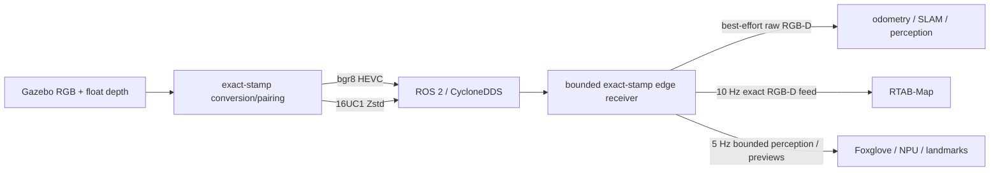

# Current Architecture

This describes repository source, not Orange Pi acceptance.

Host source is in `server_sim/src`; deployable edge source is in `edge_stack/src`.
The encoder converts depth once and emits two messages with identical Gazebo stamps
and `camera_link_optical`. The edge callbacks enqueue only shared messages; a worker
publishes the newest exact pair through shallow sensor-data QoS. Preview compression
and slow perception consumers use bounded newest-frame queues.

The edge launch composes decoder, C++ covariance injection, and RTAB-Map with
intra-process communication when SLAM is enabled. Gazebo provides odometry;
the EKF owns `odom -> base_link`, and RTAB-Map consumes `/odometry/filtered`
directly. Unused RGB-D visual odometry is not launched. The decoder preserves
exact RGB/depth pairing while RTAB-Map uses bounded approximate synchronization
to associate its gated RGB-D feed with independently stamped EKF odometry.
Flags isolate Foxglove, SLAM, NPU, landmarks,
and preview compression. Generated CycloneDDS XML is the canonical pipeline DDS
configuration and validates an explicitly requested interface/local address.

*Diagram source: [streaming contract](STREAMING_CONTRACT.md). Rates are defaults
or targets, not a new measurement. The [visual guide](VISUAL_GUIDE.md) expands
timing, ownership, control gates, and source-backed track geometry.*

Camera-only soak and bit-exact depth evidence are retained in
[VALIDATION.md](VALIDATION.md); bounded RTAB-Map acceptance is retained in
[its specification](../plans/RTABMAP_SLAM_ACCEPTANCE.md). Calibration provenance,
long-map scalability, and autonomous-lap acceptance remain scoped limitations;
see the [project ledger](PROJECTS.md) for current gates.
