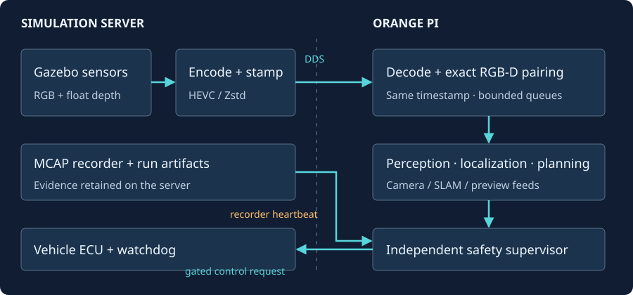

# Autonomous Gazebo documentation

Use this site to understand, run, and verify the simulation-to-edge stack.
The simulation server runs Gazebo Harmonic and ROS 2 Jazzy; the Orange Pi runs
decoding, perception, localization, and control.

*Figure 1 — Original architecture diagram derived from the [streaming contract](STREAMING_CONTRACT.md)
and [racing specification](autonomous_racing_plan.md). Arrows describe interfaces,
not proof of a completed autonomous lap.*

## Current project status

Autonomous driving remains `[W.I.P]`: scoped camera and bounded SLAM acceptance
is retained, while control fixes pass host acceptance, while trusted cone-source integration and
Orange Pi safe-lap acceptance remain open. Read the [overall project status](PROJECTS.md#overall-status-2026-10-12)
and [2026-10-12 code review](CODE_REVIEW_2026-10-12.md) for blockers and host test results.

## Find your next step

| Task | Start with |
|---|---|
| Understand data flow, timing, and control ownership | [Visual guide](VISUAL_GUIDE.md) and [current architecture](ARCHITECTURE_CURRENT.md) |
| Build and launch the simulation server | [Repository quick start](../README.md#build-and-launch) |
| Set up the Orange Pi receiver | [Edge deployment](EDGE_DEPLOYMENT.md) and [hardware inventory](EDGE_DEVICE.md) |
| Inspect topics, frames, codecs, and depth precision | [Streaming contract](STREAMING_CONTRACT.md) |
| Diagnose discovery, pairing, or latency | [Networking troubleshooting](NETWORKING_TROUBLESHOOTING.md) |
| Review what passed and what remains | [Project ledger](PROJECTS.md) and [validation evidence](VALIDATION.md) |
| Plan or verify autonomous motion | [Racing specification](autonomous_racing_plan.md) and [navigation acceptance](AUTONOMOUS_TESTING_PLAN.md) |
| Inspect overlays and recordings | [Foxglove integration](FOXGLOVE_INTEGRATION.md) |
| Run production-flow tests | [Testing guide](TESTING.md) |
| Update this site | [Documentation maintenance](DOCUMENTATION.md) |

## Read claims with their scope

Source code establishes implementation. Host tests establish only the tested host
behavior. Orange Pi evidence establishes only the recorded hardware run and its
acceptance scope. A camera-only soak does not establish a safe autonomous lap;
bounded RTAB-Map acceptance does not establish long-map scalability.

The [project ledger](PROJECTS.md) records current status and remaining gates.
[Validation](VALIDATION.md) retains the investigation chronology, including failed
and superseded trials. Historical documents are available in the archive menu and
carry a warning on every page.

## Server and Orange Pi boundaries

Commands labeled **Orange Pi** run on the edge device. This repository checkout is
the simulation server. The website build requires no ROS nodes or device access.
The [workflow](CODEX_WORKFLOWS.md) describes host checks and edge handoffs.
