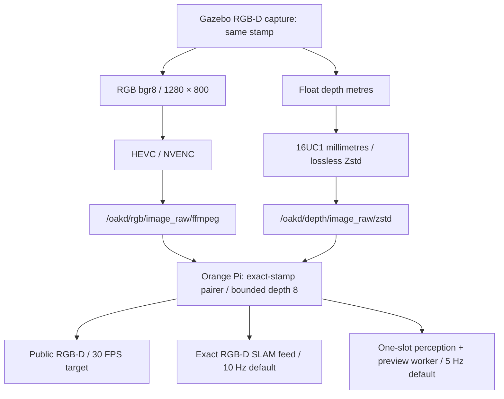
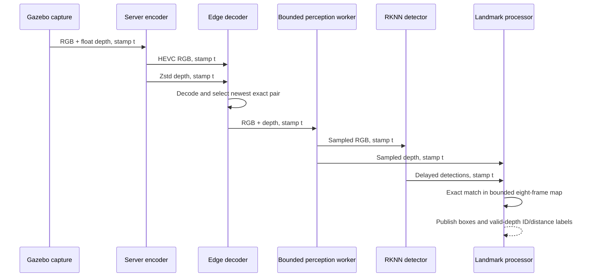
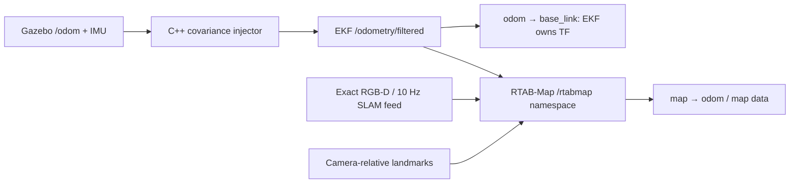
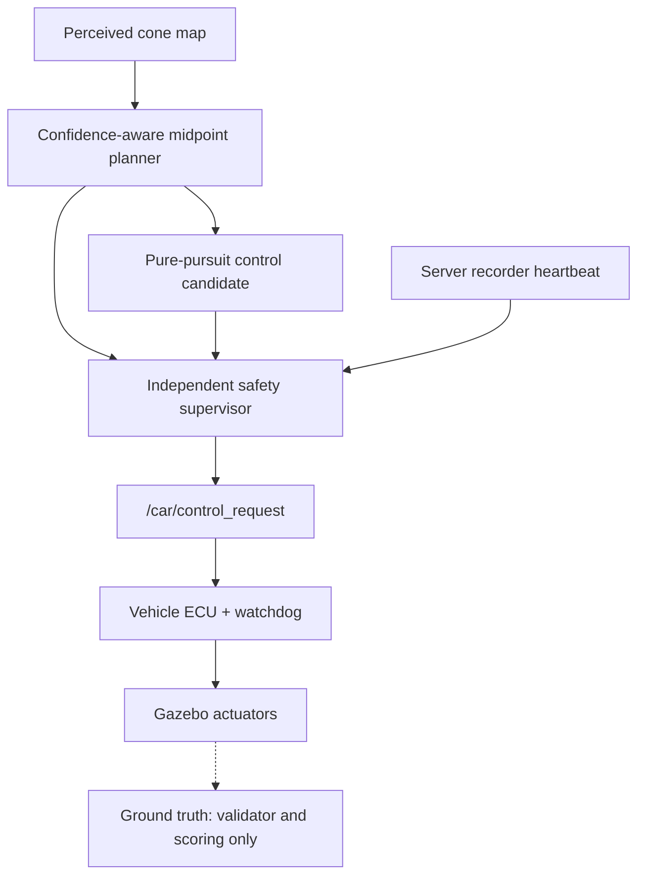

# Visual guide to the stack

These diagrams summarize current interfaces and explicit project requirements.
Each figure cites its source. They are explanatory views, not new execution evidence.

## One capture, two wire streams



*Figure 2 — Derived from the [streaming contract](STREAMING_CONTRACT.md).
Rates labeled target/default describe the interface policy; measured performance
is recorded in [validation](VALIDATION.md). Public outputs use best-effort
KeepLast(1), while CameraInfo uses reliable KeepLast(1).*

## Exact pairing and delayed detections



*Figure 3 — Derived from [perception synchronization and annotations](STREAMING_CONTRACT.md).
The ordering is illustrative; arrival order may vary. Missing or evicted depth
must not be replaced with a different timestamp.*

## Transform and odometry ownership



*Figure 4 — Derived from [full-stack odometry and synchronization](STREAMING_CONTRACT.md).
RGB/depth are exact-paired upstream; RTAB-Map associates them with independently
stamped EKF odometry using bounded approximate synchronization (50 ms, queue 10).
RGB-D visual odometry is not launched in the current full-stack configuration.*

## Motion is gated independently



*Figure 5 — Derived from the [racing runtime architecture](autonomous_racing_plan.md#runtime-architecture).
Production planning does not consume evaluation ground truth. Host control-plane
verification is retained; Orange Pi perception-driven Gate A remains pending.*

## Track geometry example


*Figure 6 — SVG generated directly from [checked-in Catalunya coordinates](../server_sim/src/my_gazebo_package/my_gazebo_package_py/track_layouts.py).
Geometry is plotted with equal x/y scale and inverted screen y; the gold circle is
the `(0, 0)` spawn. This is a centerline illustration, not a measured vehicle path
or an official circuit survey. The source labels it `svg_vector_translation` but
does not retain the original upstream SVG attribution.*

The [track selection regression](../server_sim/src/my_gazebo_package/test/test_track_selection_contract.py)
checks the default, vector metadata, point density, and entry-point selection.

## Acceptance moves with retained evidence

```mermaid
flowchart LR
  P["PLAN: scope and mandatory cases"] --> W["W.I.P: failing test → implementation → passing test"]
  W --> V["VERIFICATION: automated acceptance + nominal/adversarial runs"]
  V --> C["COMPLETE: all mandatory cases passed and retained"]
```

*Figure 7 — Derived from the [repository workflow](CODEX_WORKFLOWS.md#documentation-and-completion)
and [project ledger](PROJECTS.md). Status refers to the specific project scope.*

## Visual sources and reuse

All diagrams on this page are original repository documentation, derived from the
linked contracts and specifications. The track figure is derived from repository
data; upstream attribution is incomplete as noted above. No third-party photos,
uncited detection screenshots, or generated performance images are presented as
evidence. The repository has no declared project-wide license; these captions
describe provenance rather than grant reuse rights.

Diagram authoring references: [Mermaid flowchart syntax](https://mermaid.js.org/syntax/flowchart.html)
and [Mermaid sequence diagram syntax](https://mermaid.js.org/syntax/sequenceDiagram.html).
Readers can expand the source beneath each diagram to inspect or reuse its logic.
