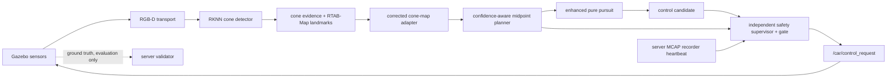

# [W.I.P] Autonomous Racing Pathing

Host implementation note: canonical `autonomous_racing_msgs` interfaces are shared by `edge_stack` and `server_sim` through one source package plus a server workspace symlink. Production launches now use the C++ cone-map adapter, midpoint planner, pure-pursuit controller, and independent safety supervisor; typed prepare/start/abort services, control candidates, supervisor status, and recorder heartbeats replace prototype JSONL contracts. Host orchestration explicitly calls supervisor prepare, recorder prepare, recorder start after a healthy heartbeat, supervisor start, then paired aborts; the supervisor does not make nested recorder RPCs. The server `run_recorder_node.py` coordinates an explicit rosbag2 MCAP allowlist with atomic manifest/summary artifacts and heartbeat. Host builds and regressions pass; Orange Pi Gate A evidence remains pending.

## Objective

The Orange Pi shall drive the simulated vehicle around an initially unknown,
static cone track using only simulated sensor data processed through the production
perception, localization, mapping, planning, and control path.

Lap one prioritizes map quality while driving at an adaptive speed no greater than
2 m/s. After closing the loop, the vehicle transitions without stopping to a
confidence-aware global centerline with an initial 5 m/s ceiling. Later observations
may correct the path ahead of the vehicle without causing a discontinuous control
target.

The first accepted pathing milestone is one safe, perception-driven lap. Later-lap
speed and correction acceptance is a separate gate. Physical-car validation,
racing-line optimization, self-intersecting tracks, dynamic obstacles, and general
Nav2 navigation are outside this project.

## Deployment boundary

- Gazebo, vehicle dynamics, track generation, evaluation-only ground truth, and
  authoritative MCAP recording run on the simulation server.
- NPU perception, RTAB-Map, path planning, confidence evaluation, pure pursuit,
  and the safety supervisor run on the Orange Pi.
- Production decisions use perceived data only. Ground truth must not be visible
  to mapping, planning, confidence, speed selection, or control nodes.
- The server records Orange Pi topics through ROS 2/DDS over the configured
  network or Tailscale path.
- Every run starts with an empty run-local cone map and path. Maps and paths are
  not reused after restart.

## Operating assumptions

- V1 supports static, simple closed cone loops, including bends and hairpins but
  excluding self-intersections such as figure-eight tracks.
- The initial localized vehicle pose defines the start/finish gate; initial heading
  defines travel direction.
- Cones have no reliable left/right or color class. Boundary inference uses
  geometry and temporal continuity.
- The vehicle travels forward. Obstacle avoidance is out of scope.
- Simulation ground truth is permitted only in the validator, scoring, MCAP, and
  offline confidence-calibration tools.

## Runtime architecture



The production pathing core is C++. The planner and controller may use one
composition container, but the supervisor and command gate run in a separate
process. Python remains appropriate for MCAP analysis and development utilities.

The supervisor is the only authority that enables motion. The planner and
controller may propose paths and commands, but neither publishes directly to the
vehicle command topic. The existing vehicle/ECU watchdog remains the final
independent stop layer.

## Shared ROS interfaces

Create one canonical `autonomous_racing_msgs` package and expose that same package
to both `edge_stack` and `server_sim`; do not duplicate message definitions.

### Cone map

`ConeEstimate` contains:

- stable run-local ID;
- `map`-frame pose and covariance;
- detector score;
- observation count and distinct-view count;
- last-observed stamp;
- depth/pose quality;
- association confidence;
- state: `PROVISIONAL`, `PERSISTENT`, or `QUARANTINED`.

`ConeMap` contains a header, map revision, localization confidence, and cone
estimates. The adapter produces this normalized contract from provisional
perception evidence and RTAB-Map-corrected persistent landmarks.

The Orange Pi implementation must first inspect its installed RTAB-Map interfaces
and prove how optimized landmark IDs and poses are recovered. The server checkout
does not have `rtabmap_msgs` installed. If no direct corrected landmark topic
preserves IDs, the adapter shall associate RTAB-Map's optimized landmark poses
with run-local persistent IDs and reject ambiguous associations rather than use
the cone processor's frozen map positions.

### Racing path

`RacingPathPoint` contains:

- `map`-frame pose;
- target speed;
- aggregate confidence in `[0, 1]`;
- observation-support, pose-quality, corridor-geometry, continuity, and recency
  confidence components;
- state: `TRUSTED`, `DEGRADED`, or `UNSAFE`.

`RacingPath` contains:

- header in `map`;
- monotonically increasing revision;
- mode: `ROLLING` or `GLOBAL`;
- closed-loop flag;
- ordered `RacingPathPoint` values.

The controller consumes `RacingPath`. Derived `nav_msgs/Path` and visualization
markers are for inspection only and are not control inputs.

### Supervisor and recording

Typed status interfaces carry:

- supervisor state and latched-stop reason;
- planner/controller readiness and heartbeat;
- active and candidate path revisions;
- path-revision acceptance or rejection reason;
- recorder state, run ID, and heartbeat.

Use explicit prepare, start, and abort operations. Host orchestration calls
supervisor `/racing/prepare`, recorder `/racing/recorder/prepare`, verifies a
healthy heartbeat, calls `/racing/recorder/start`, then calls supervisor
`/racing/start`:

1. `prepare` creates a run ID and resets run-local state; fresh recorder heartbeat
   is required before motion can start.
2. `start` is an explicit operator command that opens the gate only when the
   recorder heartbeat is fresh.
3. `abort` immediately closes the gate, publishes zero, marks the run aborted,
   and remains latched until a new prepare operation; recorder abort finalizes
   the MCAP summary.

This is a clean interface break. Remove the prototype racing topic contract and
update all consumers together.

## Supervisor state and safety contract

The supervisor state machine is:

```text
IDLE -> PREPARING -> READY -> EXPLORING -> RACING
                       |          |           |
                       +------> STOPPING <----+
                                  |
                      COMPLETE / FAILED / ABORTED
```

- Motion cannot begin before explicit operator `start`.
- The command gate publishes at 50 Hz.
- The controller publishes `/racing/control_candidate`; only the gate publishes
  `/car/control_request`.
- Any critical failure closes the gate, commands zero speed, records the reason,
  and latches the run.
- Default freshness limits are 200 ms for odometry, active path, and controller
  command; 500 ms for perception and server-recorder heartbeat. All are parameters
  with lower bounds enforced by validation.
- Recorder/network loss is a hard interlock. The Orange Pi performs the stop; it
  never depends on the server delivering a final zero command.
- Automatic recovery must not reopen the gate. A new run is required.

## Cone evidence and confidence

Runtime confidence is computed exclusively from onboard evidence. Simulation
ground truth evaluates calibration after the fact.

Persistent RTAB-Map-corrected cones are authoritative anchors. Provisional cones
may support the rolling planner with reduced weight when they agree with corridor
geometry. A conflicting observation is quarantined, excluded from control, and
admitted only after repeated consistent observations from distinct vehicle poses.

Default path confidence weights are:

| Component | Weight |
|---|---:|
| Observation support and view diversity | 0.30 |
| Pose/depth uncertainty | 0.25 |
| Corridor geometry and two-sided support | 0.25 |
| Path and boundary continuity | 0.10 |
| Recency | 0.10 |

Localization confidence caps the aggregate result. Long gaps, one-sided support,
ambiguous associations, implausible width, boundary crossing, and abrupt curvature
reduce confidence. Hard clearance or vehicle-feasibility failures make a section
`UNSAFE` regardless of its numeric score.

Default section thresholds are:

- `TRUSTED`: confidence at least 0.75;
- `DEGRADED`: confidence at least 0.40 and below 0.75;
- `UNSAFE`: confidence below 0.40 or any hard invariant failure.

Weights and thresholds are parameters, but acceptance uses the defaults until
retained MCAP evidence justifies a documented change.

## Path construction

### Rolling exploration path

1. Select fresh forward cones within the perception horizon.
2. Construct short, plausible cone-to-cone connections using distance, heading,
   learned track width, temporal continuity, and confidence.
3. Use connection midpoints as center candidates.
4. Select the forward-continuous midpoint route consistent with the initial travel
   direction and current progress.
5. Fit a constrained spline inside the inferred corridor.
6. Publish a rolling `map`-frame path with confidence and speed at every point.

The planner must not invent an unconditional straight path when no cones are
usable. Insufficient safe geometry produces an unsafe status and a stop.

### Closed global path

During lap one, the planner accumulates corrected cones and constructs a global
midpoint graph. A closed-path candidate must satisfy:

- continuous topology from and back to the start gate;
- no self-intersection for V1;
- plausible, consistently ordered corridor geometry;
- vehicle clearance from both inferred boundaries;
- curvature and steering feasibility;
- continuous heading and curvature at closure;
- confidence classification for every section.

The selected centerline is a periodic constrained spline. It optimizes safety,
clearance, and smoothness, not lap time.

If the first gate crossing occurs before a closed candidate exists, the vehicle
continues another exploration lap at no more than 2 m/s. Once a global path passes
validation, the supervisor transitions seamlessly to racing mode.

## Later-lap correction and speed

Exploration speed is adaptive and capped at 2 m/s. Racing speed is computed from
curvature, clearance, localization confidence, and path confidence, with an
initial ceiling of 5 m/s.

- Trusted sections may use the racing profile.
- Degraded sections slow to exploration speed and request a bounded RTAB-Map
  mapping window.
- Outside correction windows, RTAB-Map operates in localization mode to reserve
  compute for faster control and perception.
- Unsafe or missing global sections may use a newly validated rolling path at
  exploration speed. If no safe rolling path exists, the supervisor stops.

RTAB-Map mapping/localization mode changes must be tested on the Orange Pi to prove
that the current map and landmark identities survive the transition.

### Live path revision

A new corrected path is a candidate until it:

1. passes topology, clearance, curvature, steering, and confidence invariants;
2. remains continuous with the committed control horizon;
3. materially improves confidence, clearance, or consistency in the affected
   forward region.

The active path immediately around the vehicle remains committed. The planner
preserves at least the larger of the current lookahead or 0.5 seconds of travel,
then blends toward the candidate over at least the larger of twice the lookahead
or 1.0 second of travel. Any candidate that cannot meet the blend constraints is
rejected.

Default material-improvement thresholds are 0.05 aggregate confidence or 0.10 m
minimum-clearance improvement without causing another section to regress to
unsafe. Insignificant revisions are ignored to prevent path churn.

## Controller

Retain pure pursuit as the V1 controller and rewrite its production core in C++.

- Use the actual 1.511 m wheelbase and configured steering/velocity limits.
- Consume only the typed active racing path in `map`.
- Resolve timestamped `map -> base_link` transforms; do not support mixed path
  frame semantics.
- Run at 50 Hz.
- Use each path point's target speed rather than a node-wide constant.
- Apply curvature/confidence speed regulation and steering continuity limits.
- Publish candidate commands only.
- Missing, stale, unsafe, or untransformable paths produce a zero candidate and a
  fault status.

## MCAP-first run artifacts

The simulation server runs a coordinator around rosbag2 using the MCAP storage
backend. It must not implement a custom MCAP writer.

Each run produces:

```text
telemetry/run_<UTC>_<run_id>/
├── bag/                  # metadata.yaml and one or more *.mcap segments
├── run_manifest.json
└── run_summary.json
```

The manifest is written before motion and includes run ID, UTC start, revisions,
dirty-worktree state, launch arguments, parameters, track/seed, topic contract,
host/edge identities, and recording limits. The summary is written atomically
after stop and includes the terminal state, lap results, faults, path/control
metrics, confidence calibration, bag integrity, and artifact paths.

Recording is ready before the supervisor opens the motion gate. The recorder
publishes a 10 Hz heartbeat; loss for 500 ms latches a stop.

Every run records an explicit allowlist containing:

- `/clock`, `/tf`, and `/tf_static`;
- odometry, localization, RTAB-Map graph/landmark outputs, and diagnostics;
- raw cone evidence and normalized cone maps;
- active, candidate, accepted, and rejected path revisions;
- confidence components, section states, speed profiles, and blend regions;
- supervisor states, readiness, faults, candidate commands, and final commands;
- validator outputs and evaluation-only ground truth;
- compressed RGB, camera calibration, and YOLO annotations.

Required topics must contain data across the driven interval. An empty required
topic makes the run invalid. Normal completion, failure, abort, timeout, recorder
death, and storage-limit termination must leave either a valid bag or an explicitly
incomplete recoverable artifact.

Remove the JSONL time-series recorder and its launch/configuration paths in the
first implementation slice. JSON remains only for the manifest and summary.

## Foxglove review contract

Add `/racing/.*` to the Foxglove bridge whitelist.

- Publish the active path as a prominent continuous line strip with per-point
  red-to-yellow-to-green colors for unsafe-to-trusted confidence.
- Show the corrected candidate as a thinner translucent line.
- Mark unsafe gaps, state transitions, and blend boundaries explicitly.
- Show the most recently rejected candidate temporarily with the failed region and
  rejection reason.
- Publish section diagnostics containing aggregate confidence and observation,
  uncertainty, geometry, continuity, recency, localization, revision, and speed
  components.
- Record all visualization and diagnostic topics in MCAP so post-run Foxglove
  replay matches the live display.

## Implementation sequence

All implementation follows test-driven development: add a failing behavioral or
interface test, implement the minimum passing change, then refactor with tests
green.

1. Add the shared message/service package and clean-break topic contract.
2. Delete JSONL telemetry and implement server MCAP lifecycle, manifests,
   summaries, content checks, and heartbeat.
3. Implement the independent C++ supervisor and command gate with simulated
   readiness/fault sources.
4. Expose normalized cone evidence and prove corrected landmark extraction on the
   Orange Pi.
5. Implement midpoint graph selection, confidence, constrained rolling spline, and
   unsafe-gap behavior.
6. Implement the C++ pure-pursuit controller and confidence/curvature speed
   regulation.
7. Implement global closure, start-gate lap logic, localization/targeted-mapping
   modes, candidate validation, and forward blending.
8. Add Foxglove confidence visualization and MCAP replay diagnostics.
9. Execute deterministic, fixed-track, unseen-track, later-lap, and adversarial
   gates with retained evidence.

## Automated verification

### Unit and component coverage

- Cone weighting, distinct-view support, quarantine, re-observation, and ambiguous
  association rejection.
- Midpoint graph behavior with unequal sides, missed cones, false cones, long
  gaps, hairpins, and no usable geometry.
- Spline closure, corridor containment, curvature, clearance, and steering limits.
- Confidence composition, hard unsafe overrides, thresholds, and speed profiles.
- Candidate material-improvement tests, committed horizon, forward blending, and
  rejection without active-path mutation.
- Start-gate direction, minimum-progress protection, false recrossings, and lap
  completion.
- Pure-pursuit geometry, actual wheelbase/limits, transform failures, staleness,
  and 50 Hz command behavior.
- Supervisor transitions, exclusive command ownership, explicit start, abort,
  every timeout, latched stop, and inability to auto-resume.
- MCAP readiness, topic content, run-ID consistency, finalization, incomplete
  recovery, replay clock, and transient-local `/tf_static`.
- Foxglove per-point color ramp, active/candidate distinction, unsafe markers, and
  rejected-candidate expiry.

### Integration and adversarial coverage

Mandatory fault cases are:

- stale perception;
- stale odometry or transform;
- stale or unsafe path;
- false cone quarantined without path capture;
- missing cone section recovered by a rolling path;
- missing section with no safe fallback causing a latched stop;
- loop-closure path shift accepted through a bounded forward blend;
- unsafe or insignificant correction rejected;
- server recorder or DDS/Tailscale heartbeat loss;
- RTAB-Map mapping/localization transition without map or ID loss.

Critical odometry/path/control faults must close the gate within 200 ms. Perception
and recorder faults must close it within 500 ms. No test may rely on a command from
the server to perform the stop.

## Acceptance gates

### Gate A: first safe lap

Run the complete production data path with planning and control on the Orange Pi:

1. pass all automated tests;
2. complete one lap on a fixed simple closed track at an adaptive speed no greater
   than 2 m/s;
3. repeat on an unseen seeded random simple closed track;
4. show no boundary crossing, cone collision, unsafe command, critical-input
   timeout, or ground-truth subscription in a production node;
5. retain complete server MCAP artifacts and a reviewable Foxglove confidence
   display for both runs.

Passing Gate A advances the project to global-path and later-lap verification; it
does not by itself accept 5 m/s racing.

### Gate B: global path and correction

In one continuous run:

1. complete exploration and transition without stopping to a validated closed
   global path;
2. complete a later lap with a 5 m/s ceiling and curvature/confidence regulation;
3. slow and remap a degraded section;
4. blend one safe material correction without a steering discontinuity;
5. reject one unsafe correction without changing the active path;
6. retain nominal and adversarial MCAP evidence.

`[VERIFICATION]` requires all automated coverage plus retained Gate A and Gate B
nominal/adversarial artifacts. `[COMPLETE]` requires every mandatory case above to
pass on the Orange Pi against Gazebo.

## Deferred work

- Physical-car deployment and validation.
- Figure-eight and other self-intersecting topology.
- Dynamic/static obstacle avoidance beyond cone-corridor stopping.
- Time-optimal racing-line generation and speeds above the initial 5 m/s ceiling.
- Persisted map/path reuse between runs.
- General Nav2 goal navigation.
- Comprehensive standalone perception-model acceptance; this project includes
  only the evidence and failure behavior required by pathing.
